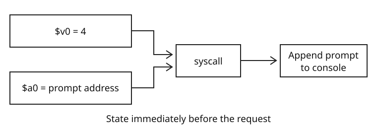

# Console service contracts

| Service selector in `$v0` | Request | Argument or result |
| --- | --- | --- |
| `4` | Print a string | `$a0` is the address of zero-terminated bytes |
| `5` | Read an integer | The returned signed integer replaces `$v0` |
| `1` | Print an integer | `$a0` holds the integer value |
| `10` | Exit normally | This example supplies no argument |

Read each row as a contract for one request. The same register can have a
different role in another row.

