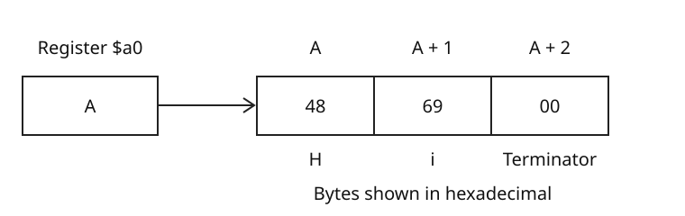

# A zero-terminated string in memory

For the independent declaration `greeting: .asciiz "Hi"`, let `A` be the
address assigned to `greeting`.

| Address | Byte in hexadecimal | Interpretation |
| --- | --- | --- |
| `A` | `48` | ASCII `H` |
| `A + 1` | `69` | ASCII `i` |
| `A + 2` | `00` | String terminator |

An argument containing `A` identifies the beginning of the sequence. The print
service reads successive bytes until it reaches the terminator. The specific
numeric address depends on the assembled layout.

