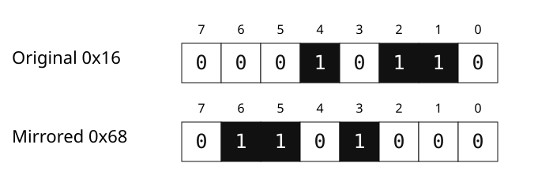

# Mirror columns by reversing a row byte

The original first row is `00010110`. The reversed row is `01101000`.
Original columns 3, 5, and 6 map to mirror columns 4, 2, and 1 respectively.
For a column c, the mirrored column is `7 − c`.

The digits provide the pattern independently of the filled cells. The native
TikZ source is the publication diagram; this SVG is a Markdown preview.
