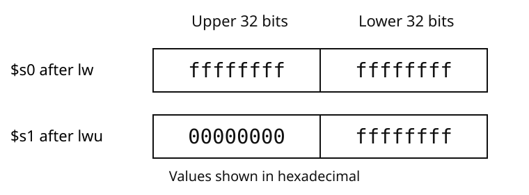

# Compare sign and zero extension

| Input word | After lw | After lwu |
| --- | --- | --- |
| `00000001` | `0000000000000001` | `0000000000000001` |
| `7fffffff` | `000000007fffffff` | `000000007fffffff` |
| `80000000` | `ffffffff80000000` | `0000000080000000` |
| `ffffffff` | `ffffffffffffffff` | `00000000ffffffff` |

Every entry is hexadecimal. The output columns contain complete 64-bit values.

The native TikZ diagram is the publication source; the SVG is a Markdown preview.
