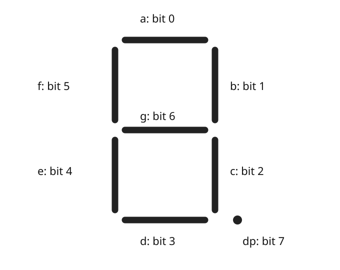

# Segment positions and bit assignments

| Bit | Segment | Position |
| --- | --- | --- |
| 0 | a | Top horizontal bar |
| 1 | b | Upper-right bar |
| 2 | c | Lower-right bar |
| 3 | d | Bottom horizontal bar |
| 4 | e | Lower-left bar |
| 5 | f | Upper-left bar |
| 6 | g | Middle horizontal bar |
| 7 | dp | Decimal point |

The table gives the meaning independently of the drawing. The native TikZ source
is the publication figure; the SVG is a Markdown preview.
