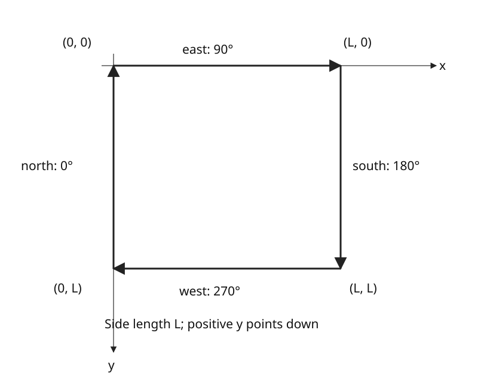

# Screen axes and a clockwise path

| Corner | Coordinates | Incoming heading |
| --- | --- | --- |
| Start | (0, 0) | None; initially north and stopped |
| East end | (L, 0) | 90 degrees |
| South end | (L, L) | 180 degrees |
| West end | (0, L) | 270 degrees |
| North end | (0, 0) | 0 degrees |

L is the input side length. The diagram uses screen axes. Its native TikZ source
is the publication figure; this SVG is a draft preview.
