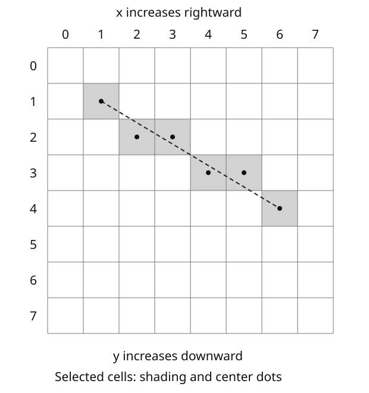

# Default line on the cell grid

The selected coordinates are (1,1), (2,2), (3,2), (4,3), (5,3), (6,4). Cell centers
have integer coordinates. The continuous segment is explanatory geometry; the stored
image consists only of the selected cell words. The native TikZ source is the
publication figure and this SVG is a Markdown preview.
