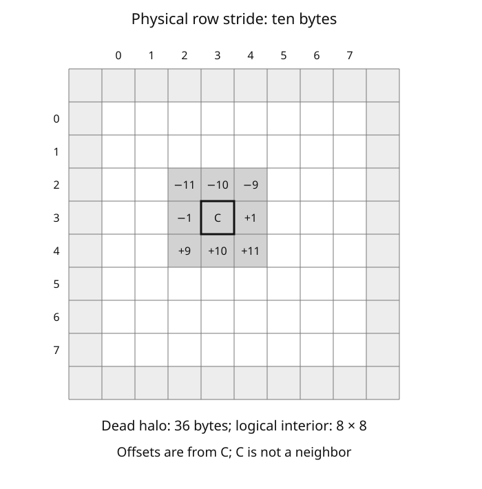

# The padded board and neighbor offsets

| Relative row | Left | Center column | Right |
| --- | --- | --- | --- |
| Above | −11 | −10 | −9 |
| Same | −1 | Current cell, not counted | +1 |
| Below | +9 | +10 | +11 |

Logical (0,0) is physical offset 11. Logical (7,7) is offset 88. The smallest
neighbor address is base+0 and the largest base+99, so every permitted load is
inside the 100-byte allocation. The halo has 100−64 = 36 permanently dead bytes.
