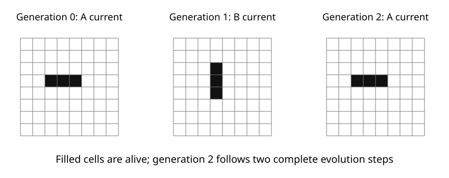

# A two-step oscillator in the two buffers

Generation 0: (2,3), (3,3), (4,3). Generation 1: (3,2), (3,3), (3,4).
Generation 2: (2,3), (3,3), (4,3). The text coordinates describe the image without
relying on color. At the final boundary A contains generation two and B retains
one, so a repeated image does not erase the intermediate state.
