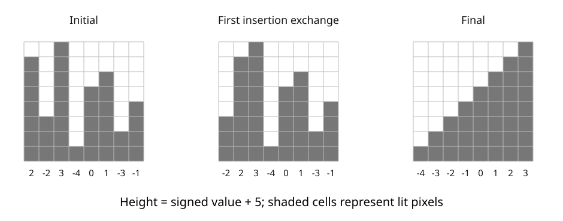

# Three states of the default insertion trace

The middle image follows the first complete exchange, not the first store of that
exchange. Shading identifies cells that would be lit in Bitmap Display. Values are
printed beneath the grids so bar heights do not need to carry signed meaning alone.
